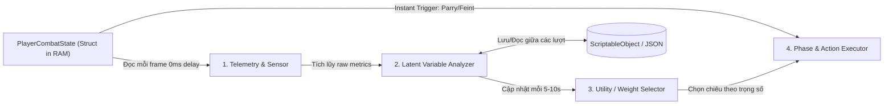

# Kế Hoạch Thiết Kế Core: Adaptive Boss AI (RAM State & Dynamic Weighting)

Tài liệu này tập trung vào kiến trúc lõi (Core Architecture), luồng dữ liệu, công thức tính biến ẩn và cơ chế ra quyết định để bạn tự triển khai code trong [Boss.cs](file:///f:/UnityProject/prototype_1-2026-10-01_22-48-36/Assets/2.Script/Boss.cs) và các module liên quan.

---

## 1. Kiến Trúc Tổng Thể (4 Module Core)

---

## 2. Cấu Trúc Dữ Liệu Lõi (Data Structures)

### A. `PlayerCombatState` (Struct cấp phát trên Stack/RAM, cập nhật mỗi frame từ Player)
*Dùng `struct` thay vì `class` để tránh GC và đọc trực tiếp qua tham chiếu (`ref readonly` hoặc con trỏ memory).*
- **Trạng thái tức thời (Frame-level - Phục vụ Input Reading):**
  - `CurrentAction`: Enum (`Idle`, `Move`, `AttackStartup`, `AttackActive`, `AttackRecovery`, `DodgeRoll`, `DodgeRecovery`, `Jump`, `Guard`).
  - `ActionFrameCounter`: Số frame đã trôi qua của hành động hiện tại (để Boss canh đúng cửa sổ endlag hoặc parry).
  - `IsGrounded`: `bool`.
  - `Position`, `Velocity`: `Vector2` / `Vector3`.
- **Bộ đếm tích lũy (Window Counters - Reset hoặc trượt theo cửa sổ 5-10s):**
  - `AttackCount`, `DodgeCount`, `JumpCount`: `int`.
  - `GroundTime`, `AirTime`: `float`.
  - `AverageDistanceToBoss`: `float` (tích lũy khoảng cách mỗi frame chia cho tổng số frame).

### B. `PlayerProfileData` (Lưu trữ qua `ScriptableObject` + Serialize ra `JSON`)
- Lưu trữ **4 Biến Ẩn (Latent Variables)** chuẩn hóa trong khoảng `[0.0f - 1.0f]`:
  - `GroundAffinity` (Xu hướng bám đất vs trên không)
  - `Aggressiveness` (Mức độ hổ báo)
  - `Passivity` (Mức độ bị động / giữ khoảng cách / thủ)
  - `DodgeTendency` (Tần suất spam né)
- Lưu hệ số **Prior Weight** từ các lượt chơi trước (dùng Exponential Moving Average - EMA để pha trộn giữa thói quen cũ ở các trận trước và hành vi mới trong trận hiện tại).

---

## 3. Công Thức Tính Biến Ẩn (Cập nhật mỗi 5 - 10s)

Gọi $\Delta t$ là chu kỳ đánh giá (5-10s):

1. **Ground Affinity** $\in [0, 1]$:
   $$\text{GroundAffinity} = \frac{\text{GroundTime}}{\text{GroundTime} + \text{AirTime}}$$
2. **Aggressiveness** $\in [0, 1]$:
   - Tính dựa trên tần suất ra đòn ($\text{AttacksPerSec} = \text{AttackCount} / \Delta t$) kết hợp với việc đứng gần Boss ($\text{Distance} < \text{MeleeThreshold}$).
3. **Passivity** $\in [0, 1]$:
   - Tăng cao khi $\text{AverageDistanceToBoss}$ lớn, thời gian `Guard` lâu và $\text{AttacksPerSec}$ thấp.
4. **Dodge Tendency** $\in [0, 1]$:
   - Tính theo $\text{DodgesPerSec} = \text{DodgeCount} / \Delta t$ hoặc tỷ lệ phản xạ bấm Dodge ngay khi Boss vừa vào trạng thái `AttackStartup`.

> **Cập nhật liên tục & Lưu trữ (EMA):**
> `NewLatent = Lerp(SavedLatent, CurrentWindowLatent, LearningRate)` (với `LearningRate` $\approx 0.3 - 0.5$ trong trận, và ghi đè xuống JSON khi kết thúc trận / Phase).

---

## 4. Hệ Thống Phase & Ma Trận Khắc Chế

### Giai đoạn trận đấu (State Machine)
| Phase | Ngưỡng HP | Hành vi Core |
| :--- | :--- | :--- |
| **Phase 1** | `100% - 70%` | • Trọng số các chiêu đều nhau (Default Weights). • Chạy ngầm `Telemetry` thu thập `PlayerCombatState` để lấy baseline cho các biến ẩn. • Cuối Phase 1: Chốt bộ trọng số khởi điểm cho Phase 2. |
| **Phase 2** | `70% - 20%` | • Bật bộ lập lịch `Coroutine / Timer` mỗi **5-10s** tính lại 4 biến ẩn. • Áp dụng **Ma trận khắc chế** để nhân hệ số ưu tiên (Weight Multiplier) vào từng nhóm chiêu. • Kích hoạt **RAM Input Reading** (phản xạ 0ms). |
| **Phase 3** | `< 20%` | • Ngắt hàng đợi chiêu thông thường, kích hoạt **Ultimate AoE (100% Max HP Damage)**. • **Telegraph 3.0s**: Bật cảnh báo визуал/âm thanh, kích hoạt bục nhảy (Platform) hoặc mở cửa sổ check I-frame ở frame nổ sát thương. • Sau Ultimate: Duy trì trạng thái thích ứng cao nhất của Phase 2. |

### Ma Trận Khắc Chế (Phase 2 Weight Modifiers)
Mỗi kỹ năng của Boss (`BossSkill`) gắn tag phân loại. Điểm ưu tiên của chiêu:
`FinalWeight = BaseWeight * (1 + LatentValue * CounterMultiplier)`

- **Khi `GroundAffinity` cao (> 0.65):**
  - Tăng mạnh trọng số trạng thái `AirborneMode` (Boss bay/nhảy lên không).
  - Tăng trọng số nhóm chiêu `SeismicTrap` ép Player phải nhảy.
- **Khi `Aggressiveness` cao (> 0.65):**
  - Tăng trọng số nhóm chiêu `Guard / Parry` và chiêu có `HyperArmor / Poise` .
- **Khi `Passivity` cao (> 0.65):**
  - Tăng trọng số nhóm chiêu `GapCloser` và `GuardBreak`.
- **Khi `DodgeTendency` cao (> 0.60):**
  - Mở khóa cờ `EnableFeint = true` trên các đòn đánh thường/nặng của Boss.

---

## 5. Cơ Chế Đọc RAM 0 Độ Trễ & Feint (Frame-Perfect)

Trong hàm `Update()` hoặc `FixedUpdate()` của Boss, đọc trực tiếp `ref readonly PlayerCombatState`:

1. **Instant Parry / Counter (Khắc chế Aggressive):**
   - **Điều kiện:** Boss đang `Idle/Move`, `Aggressiveness` cao, phát hiện `PlayerState.CurrentAction == AttackStartup` ở cự ly gần và `ActionFrameCounter == 1`.
   - **Hành động:** Boss lập tức chuyển sang animation `Parry` hoặc bật `Poise` ngay trong frame đó (0ms delay).

2. **Cơ chế Feint - Hủy chiêu trừng phạt Roll (Khắc chế Dodge Spam):**
   - **Điều kiện:** Boss đang trong giai đoạn `AttackStartup` (vung vũ khí doạ đánh) và cờ `EnableFeint == true`.
   - **Đọc RAM:** Ngay frame phát hiện `PlayerState.CurrentAction == DodgeRoll` (Player vừa bấm né sớm vì thấy Boss vung tay).
   - **Hành động:**
     1. Boss **Cancel** ngay animation đòn đánh hiện tại (không tốn recovery).
     2. Tính toán vị trí kết thúc cú roll của Player: `PredictedPos = Player.Position + RollDirection * RollDistance`.
     3. Chuyển thẳng sang đòn **Punish / Roll-Catch** canh đúng thời điểm `PlayerState.CurrentAction` chuyển sang `DodgeRecovery` (endlag của cú lộn).

---

## 6. Lộ Trình Code Đề Xuất (Checklist triển khai)

1. **Bước 1 - Data & RAM State:** Định nghĩa `struct PlayerCombatState` và gắn vào script điều khiển Player để cập nhật mỗi frame.
2. **Bước 2 - Persistence:** Tạo `ScriptableObject` chứa 4 biến ẩn + hàm `SaveToJson() / LoadFromJson()` trong `Application.persistentDataPath`.
3. **Bước 3 - Telemetry & Analyzer:** Viết bộ đếm thời gian/hành động trong [Boss.cs](file:///f:/UnityProject/prototype_1-2026-10-01_22-48-36/Assets/2.Script/Boss.cs), cài đặt bộ đếm 5-10s để chuẩn hóa ra 4 biến ẩn `[0..1]`.
4. **Bước 4 - Skill Selector & Phase FSM:** Thiết lập danh sách chiêu với `BaseWeight` + `CounterTag`, viết hàm bốc thăm theo trọng số (Weighted Random) và chuyển Phase theo % HP (100-70, 70-20, <20).
5. **Bước 5 - Frame-Perfect Interrupt & Ultimate:** Thêm nhánh kiểm tra RAM trực tiếp trong `Update()` cho `Feint / Parry`, và thiết lập Coroutine 3s Telegraph cho đòn Ultimate ở Phase 3.
